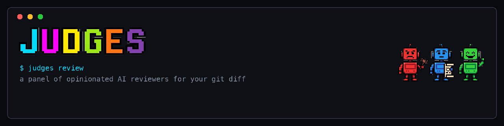

# Judge: The AI-Powered Code Quality Assistant

**Judge** is a fast, pluggable CLI tool that uses Small/Large Language Models to review your code against specific, focused rules. Instead of a single monolithic "Clean Code" prompt, Judge uses multiple specialized AI agents in parallel (e.g., SRP Validator, DRY Principle, Documentation Reviewer) to evaluate your git diffs or specific files.

## Features
- **Parallel Evaluation**: Evaluates all your judges concurrently for blazing fast results.
- **Progressive Disclosure UI**: Beautiful terminal spinners that summarize issues natively using `--short`, `--top X`, or `--full`.
- **JSON Output**: Fully parsable output (`--json`) built for AI Agents (like Claude Code) to use in their workflows.
- **Git Hook Ready**: Easy to drop into Husky for automated pre-commit code reviews.
- **Pluggable Judges**: Easy YAML + Markdown definitions (`JUDGE.md`) to add custom rules for your specific team or project.
- **Markers**: `rule-exception` / `rule-debt` comments with a reason mark deliberate exceptions and known debt; the judge decides what each one covers and lists the findings it covered. `judge markers` lists them all. See [docs/markers.md](docs/markers.md).
- **Rule tests**: a rule directory (`rules/<id>/RULE.md`) keeps tests next to the rule: code, a change or a commit of the repository, and the result the rule must give. `judge test` runs them and says which pass. See [docs/judge-format.md](docs/judge-format.md#testing-rules).

---

## Installation

Install globally via NPM:

```bash
npm install -g judge-cli
```

Once installed globally, the `judge` command is available everywhere.

*(Alternatively, to install locally per-project, run `npm install --save-dev judge-cli` and map it via `npx judge` or NPX scripts).*

---

## Usage Mode

**1. Git Diff Mode**
By default, running `judge` evaluates your currently staged Git changes.

```bash
judge
```

**2. File Mode**
You can also point it at specific files instead of the git diff:

```bash
judge --file src/index.ts
judge -f src/index.ts src/utils.ts
```

**Options:**
- `--short`, `-s`: Only show the summarization line per judge (0 issues detailed).
- `--full`: Show all issues found by judges.
- `--top <X>`: Show the top X issues per judge (Default: 3).
- `--engine <name>`: Choose the AI engine to execute. Supported: `claude` (default) and `codex`.
- `--json`, `-j`: Output results in exact JSON format (for agents).
- `--on-stop <warn|fail|ignore>`: What a rule stopped by its time, turn or cost limit does to the exit code. `warn` (default) exits 3 when nothing blocked, `fail` exits 1, `ignore` keeps the exit code. See [Exit codes](#exit-codes).
- `--stage <name>`: Run only the rules of one gate: `commit` (rules without `stage` too), `push`, or `ci` (every rule). Rules of another stage are reported as skipped. Without it, every rule runs.
- `--format <gitlab|sarif|junit> --output <path>`: Also write the findings as a CI report (see [Reports for CI](#reports-for-ci)). Repeatable.
- `--root <dir>`: Repository root that agent judges explore and file paths are shown relative to (default: the git root). File input only; with a diff mode it is an error.
- `--help`, `-h`: Show the help message.

---

## Defining Custom Judges

Judges are simply Markdown files named `JUDGE.md` located in `~/.judge/judges/<judge-name>/` (global) or `./.judge/judges/<judge-name>/` (project local).

They follow a structure heavily inspired by AI Skills, utilizing YAML Frontmatter for configuration and Markdown for the system prompt.

👉 **[Read the full guide on Creating Custom Judges and Supported Frontmatter Options](./CREATING_JUDGES.md)**

The system will automatically discover any `JUDGE.md` files in those directories and run them in parallel.

---

## 🚦 The "Green, Refactor" Workflow (Recommended)

By default, `judge-cli` is **non-blocking**. Even if it finds high severity code smells, it will exit gracefully (Exit Code `0`).

We highly recommend connecting Judges to your Git `post-commit` hook. This enforces a "Green -> Refactor" workflow:
1. You make the code work and commit it.
2. The `post-commit` hook instantly triggers the Judges to evaluate what you just committed using the `--last-commit` flag.
3. You review the AI feedback, refactor the code based on the insights, and make a follow-up commit.

**Setup in Husky (`.husky/post-commit`):**
```sh
npx judge --last-commit
```

### Strict Gatekeeper Mode (`--fail-on`)

If you want the judges to act as rigid gatekeepers that physically block code from entering your repository, you can move them to a `pre-commit` hook and enforce the `--fail-on` flag:

**Setup in Husky (`.husky/pre-commit`):**
```sh
npm run test
npx judge --staged --fail-on high
```

The `--fail-on` flag accepts:
- `high`: Blocks commit if any `High` severity issue is found.
- `medium` (or `med`): Blocks on `High` or `Medium` severity.
- `low`: Blocks on virtually any issue found.

Only issues from judges that finished count. A judge that errors (e.g. the engine CLI is missing or rate-limited) or is stopped by its time, turn or cost limit is reported with a `⚠` warning, such as `⚠ my-rule: stopped (turns) after 8 turns`. Its findings never block the commit; a stopped judge changes the exit code only through `--on-stop`.

### Exit codes

| Code | Meaning |
| :--- | :--- |
| `0` | Nothing blocked and no rule stopped (or `--on-stop ignore`). |
| `1` | Blocked: a finding at or above `--fail-on`, or a stopped rule with `--on-stop fail`. |
| `2` | Usage error, for example an unknown `--fail-on` or `--on-stop` value. Found before any rule runs. |
| `3` | Nothing blocked, but a rule stopped on its time, turn or cost limit (`--on-stop warn`, the default). |

- A block wins: when something blocks, the run exits `1`, also if a rule stopped.
- Only status `stopped` gives `3`. A rule with status `error` or `skipped` does not.
- `3` is simply the next free exit code, not a standard. `judge test` has no `--on-stop` and no exit `3`: a test whose rule stopped fails as `did-not-run`.

In GitLab CI, exit `3` can make the job "passed with warnings" instead of failed, while exit `1` still fails it:

```yaml
judges:
  script:
    - npx judge --base origin/main --stage ci --fail-on high
  allow_failure:
    exit_codes: [3]
```

### Reports for CI

One run can write the findings as a GitLab Code Quality report, a SARIF log and a JUnit file, so the CI platform shows them next to the code. The n-th `--output` gets the n-th `--format`:

```sh
npx judge --staged --fail-on high \
  --format gitlab --output gl-code-quality.json \
  --format junit --output reports/judges-junit.xml
```

- Outputs are relative to the working directory; missing directories are created. Paths inside the reports are relative to the repository root.
- Reports are written before the exit, also when `--fail-on` blocks. Findings suppressed by a marker are left out.
- Severity maps `low`/`medium`/`high` to GitLab `minor`/`major`/`critical` and SARIF `note`/`warning`/`error`. JUnit has one test case per rule; a rule that errored or was stopped by a limit is an `<error>`.
- Each finding's fingerprint is the SHA-256 of its rule id, path and position among that rule's findings in the file, so it stays the same when code above it moves or the message is worded differently.
- An unknown format, or a `--format` without its `--output`, exits with code 2 before any rule runs.
